# THE BILLIONAIRE WEALTH INVESTIGATION USING SQL

Note: The SQL code for this project can be found above named Top200RichestPersonintheWorld.sql

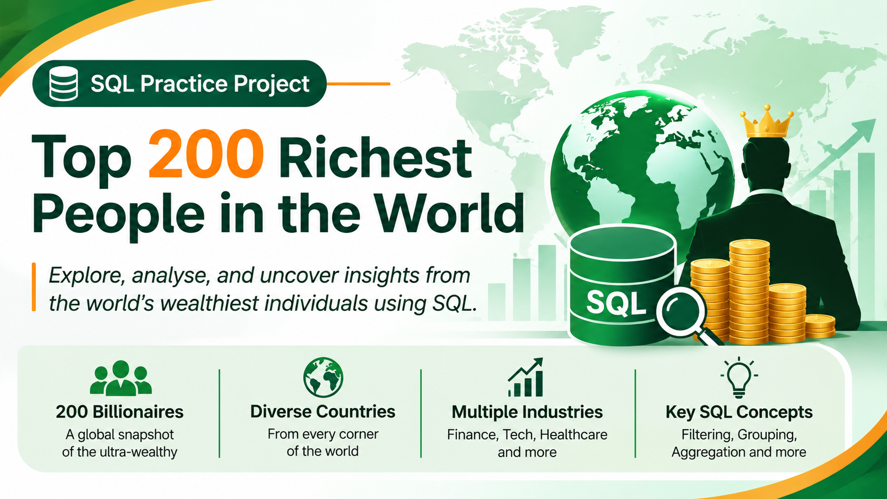

## About Dataset

The Top 200 Richest People in the World dataset contains information on 200 of the world's wealthiest individuals. It provides details about their rankings, personal demographics, countries of origin, estimated net worth, and industries through which their wealth was accumulated. For this project, SQL was used to explore the dataset, examine wealth distribution across countries and industries, identify the most represented groups, and investigate the relationship between age and net worth.

## Dataset overview:
- Total records: 200
- Total columns: 7
- Data format: CSV (Comma-Separated Values)
- Data types: Integer, decimal, and text
- Missing values: None detected in the original dataset.
- Net worth measurement: Billions of US dollars.

## Column Descriptions 
- Serial Number: Sequential numbering of the billionaires in the dataset. 
- Rank: The global ranking of the billionaire based on their net worth as per the Forbes list. 
- Name: The name of the billionaire. 
- Age: The age of the billionaire. 
- Country: The name of the country to which they belong. 
- Net worth (In Billion Dollars): The total net worth of the billionaire, expressed in billions 
of dollars. 
- Industry: The industry or sector to which the billionaire's wealth is primarily attributed. 

Link to Dataset: Top 200 Richest Person in the World Dataset 💰🌍💹 

## Skills demonstrated
- Data retrieval and filtering.
- Aggregate calculations.
- Grouping and sorting.
- Conditional filtering using WHERE and HAVING.
- Nested and correlated subqueries.
- Introduction to SQL window functions.

## SQL functions and concepts used
The following SQL functions, operators, and clauses were applied or explored during the project.
SQL function / concept	Application
- SELECT	Retrieve specific columns from the dataset.
- FROM	Specify the source table.
- WHERE	Filter records based on conditions.
- BETWEEN	Retrieve values within a specified range.
- AVG()	Calculate average age and net worth.
- SUM()	Calculate combined net worth.
- MIN()	Identify the youngest billionaire in each industry.
- MAX()	Identify the highest net worth.
- COUNT()	Count billionaires by country and industry.
- GROUP BY	Group records by country and industry.
- HAVING	Filter grouped results based on aggregate conditions.
- ORDER BY	Sort query results.
- DESC	Arrange results in descending order.
- LIMIT	Restrict the number of returned records.
- OFFSET	Skip a specified number of records.
- Subqueries	Use the result of one query within another query.

## Business Questions 

Note: The SQL code for this project can be found above named Top200RichestPersonintheWorld.sql

1. Retrieve the 20 richest billionaires.

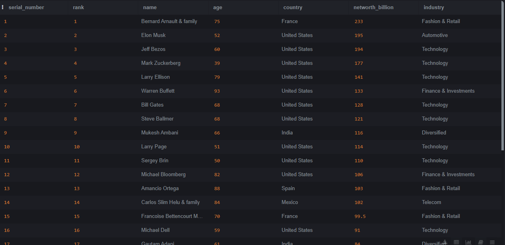

2. Identify the five youngest billionaires.

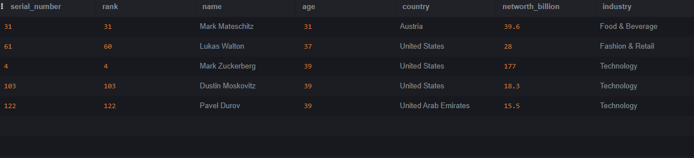

3. Calculate the average age and average net worth.

4. Identify the five most represented countries.

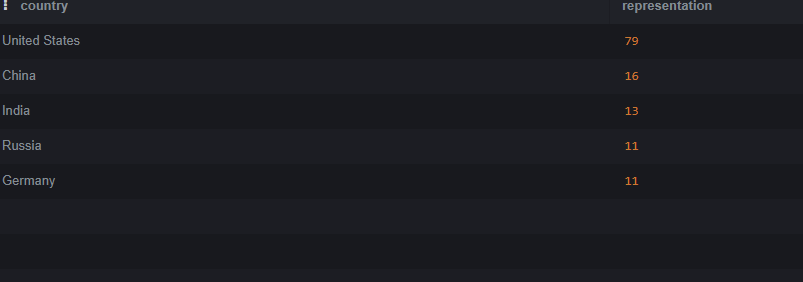 

5. Calculate the combined net worth of billionaires from each country.

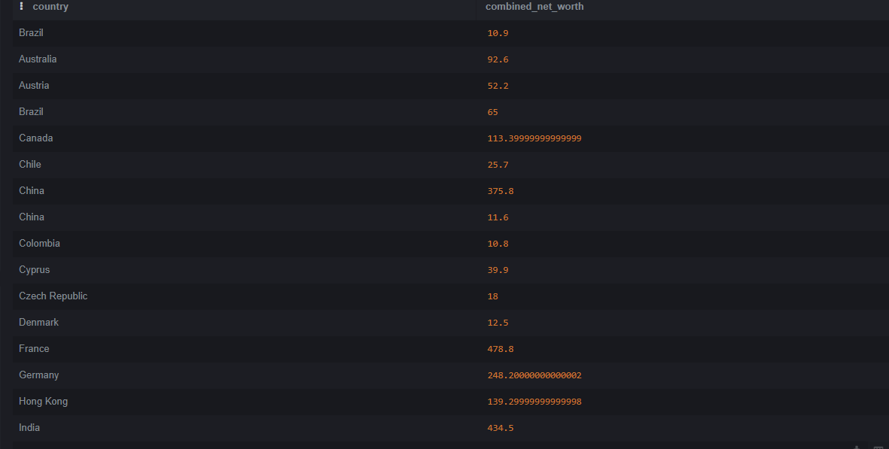

6. Identify the five industries with the highest number of billionaires.

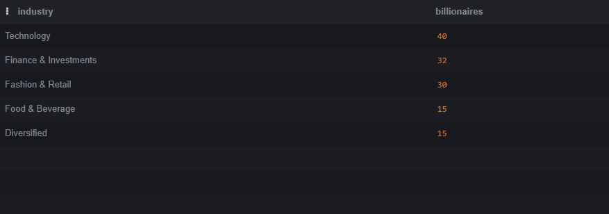

7. Find countries with at least five billionaires.

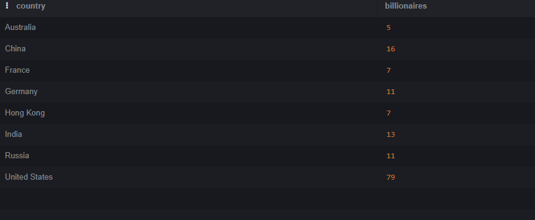

8. Calculate the total wealth of billionaires younger than 50.

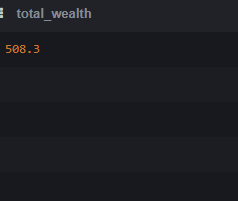

9. Identify billionaires whose net worth exceeds the overall average net worth.

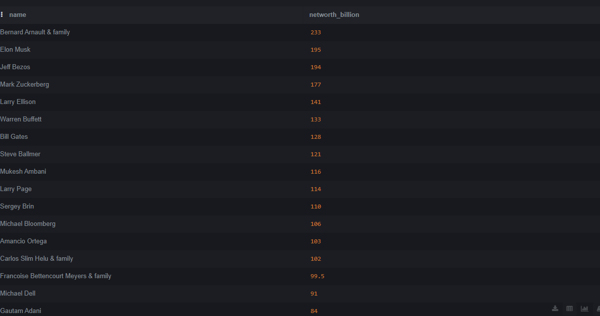

10. Identify the industry with the highest average net worth. 

11. Identify the second highest billionaire. 

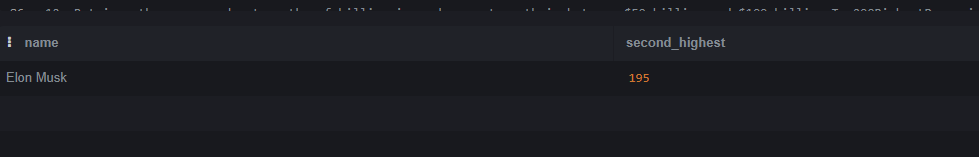

12. Retrieve the names and net worths of billionaires whose net worth is between $50 billion and $100 billion.
  
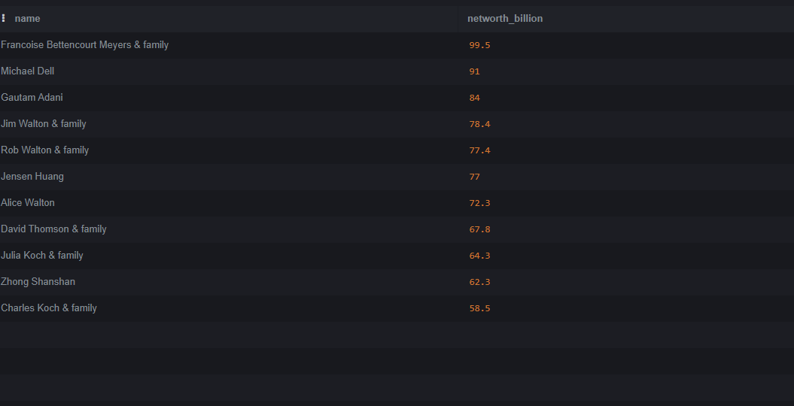

13. Calculate the difference between the highest and lowest net worth in the dataset.

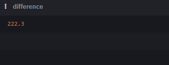

14. Identify the youngest billionaire in each industry.

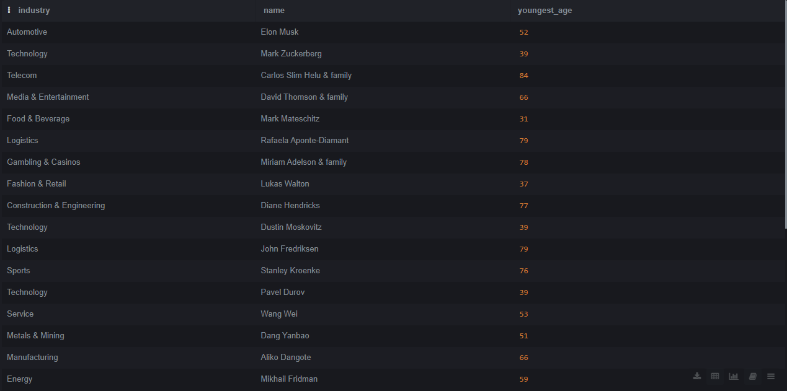

## Conclusion

The SQL analysis of the Top 200 Richest People in the World dataset provided insights into the distribution of wealth across individuals, countries, and industries. The project examined the relationship between age and net worth, identified countries with the highest representation of billionaires, and compared the average and combined wealth of different industries.

The dataset contains 200 billionaires from different countries and industries, with a combined net worth of approximately $6.37 trillion. The United States has the highest representation, with 79 billionaires, followed by China (16), India (13), Germany (11), and Russia (11).

The analysis also showed that Technology has the highest number of billionaires, with 40 individuals, while Telecom has the highest average net worth among the industries. Furthermore, 16 billionaires are younger than 50, with a combined net worth of approximately $508.3 billion.

Overall, this project provided practical experience in using SQL to retrieve, filter, aggregate, group, and analyse structured data. It also improved my understanding of how SQL can be used to answer business questions and extract meaningful insights from datasets.

Note: The SQL code for this project can be found above named Top200RichestPersonintheWorld.sql

